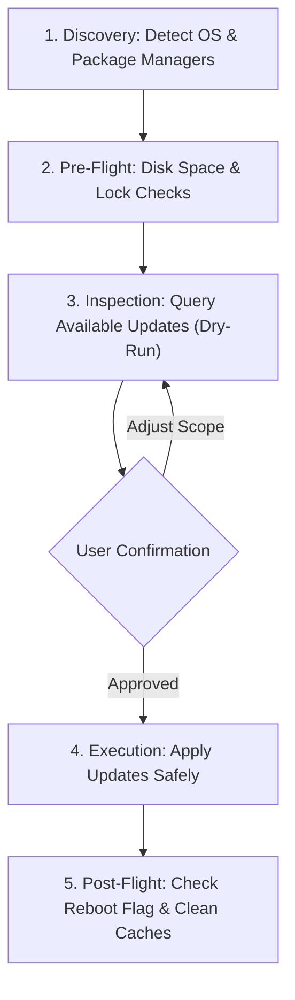

# Operating System Update & Maintenance (`os-update`)

This skill provides an automated, safety-first workflow to inspect, validate, and execute operating system and package updates on **Linux** (Debian, Ubuntu, Fedora, RHEL, Arch, openSUSE, Alpine) and **macOS** (Apple `softwareupdate`, Homebrew, and Mac App Store).

---

## Core Principles

1. **Safety First**: Never execute destructive, kernel-altering, or system-wide upgrades without pre-flight checks and explicit user approval.
2. **Inspection Before Execution**: Always run a dry-run or inspection pass first to summarize pending packages, scope, and estimated impact.
3. **Resource Guarding**: Verify available disk space on root (`/`) and boot (`/boot`) prior to downloading packages.
4. **Scope Differentiation**: Separate core system OS updates from user-space package managers (e.g., Homebrew, Flatpak, Snap).
5. **Post-Update Hygiene & Reboot Awareness**: Check if the system or running services require a reboot, clean unneeded package caches, and verify system integrity.

---

## Workflow Steps



### Phase 1: Environment & Package Manager Discovery

Run the detection helper script to identify the host operating system, architecture, running kernel, and available package managers:

```bash
./scripts/detect_os.sh
```
*(Or use `./scripts/detect_os.sh --json` for programmatic inspection)*

- Review which package managers exist on the machine:
  - **Linux**: `apt`, `dnf`/`yum`, `pacman`, `zypper`, `apk`, `flatpak`, `snap`, `brew`
  - **macOS**: `softwareupdate`, `brew`, `mas`

---

### Phase 2: Pre-Flight Safety Checks

Before touching repositories or packages, consult [references/safety-and-rollback.md](references/safety-and-rollback.md) and verify:

1. **Disk Space**:
   - Verify `/` has at least **1.5 GB free** (`df -h /`).
   - If `/boot` is a separate partition on Linux, ensure it has at least **250 MB free** (`df -h /boot`). Old kernels must not fill `/boot`.
2. **Lock Files & Concurrency**:
   - Ensure no package manager is currently running in the background (e.g. `unattended-upgrades`).
3. **Power Status**:
   - If running on a laptop/portable machine, verify it is connected to AC power or battery is > 50%.
4. **Snapshot Availability**:
   - On Linux, note if Timeshift or Snapper is available for pre-update snapshots.
   - On macOS, an instant APFS snapshot can be taken via `tmutil localsnapshot`.

---

### Phase 3: Assessment & Plan Presentation (Dry-Run)

Query pending updates across all detected package managers **without applying any changes**:

```bash
./scripts/check_updates.sh
```

Present a clear, structured summary to the user:
- Total number of pending updates.
- Breakdown by package manager / category (Core OS vs Applications vs Flatpak/Snap).
- Highlight any security-critical patches or kernel updates.
- If no updates are available, inform the user and complete the session.

Ask the user how they wish to proceed:
- **Full update** (System + applications)
- **Security-only update**
- **Specific package manager only** (e.g., Homebrew or APT only)

---

### Phase 4: Safe Execution

Once the user confirms the plan, execute updates according to the target platform:

#### Option A: Using the Automated Helper Script
```bash
# Full update (prompts for confirmation before modifying):
./scripts/update_system.sh

# Security patches only:
./scripts/update_system.sh --security-only

# Specific scope (system vs user):
./scripts/update_system.sh --scope system
./scripts/update_system.sh --scope user

# Include automatic cache cleanup:
./scripts/update_system.sh --clean
```

#### Option B: Manual Execution via Native Commands
Refer to the dedicated reference guides for nuanced flags and recovery handling:
- **Linux Distributions**: See [references/linux.md](references/linux.md)
  - Debian/Ubuntu: `sudo apt-get update && DEBIAN_FRONTEND=noninteractive sudo apt-get upgrade -y`
  - Fedora/RHEL: `sudo dnf upgrade -y`
  - Arch Linux: `sudo pacman -Syu --noconfirm` *(Never perform partial upgrades)*
  - openSUSE: `sudo zypper update -y` (Leap) or `sudo zypper dup -y` (Tumbleweed)
- **macOS System & Tools**: See [references/macos.md](references/macos.md)
  - System updates: `softwareupdate -i -r --verbose` *(Installs recommended patches; does not force major macOS version jumps)*
  - Homebrew: `brew update && brew upgrade && brew upgrade --cask`
  - Mac App Store: `mas upgrade`

---

### Phase 5: Post-Update Validation, Cleanup & Reboot Advisory

1. **Verify Package Health**:
   - Linux: Ensure no half-configured packages remain (`sudo dpkg --configure -a` or `rpm -Va`).
   - macOS: Run `brew doctor` if Homebrew was updated.
2. **Safe Hygiene**:
   - Remove obsolete dependencies (e.g., `sudo apt-get autoremove --purge -y`, `brew cleanup -s`, `flatpak uninstall --unused -y`).
3. **Reboot Requirement Check**:
   - **Debian / Ubuntu**: Check if `/var/run/reboot-required` exists. If present, inform the user which packages triggered it (`/var/run/reboot-required.pkgs`).
   - **RHEL / Fedora**: Check `needs-restarting -r`.
   - **macOS**: Check if `softwareupdate` reported a required restart.
4. **Summary Report**:
   - Provide the user with a concise summary of packages updated, disk space reclaimed, and reboot recommendation.

---

## Troubleshooting & Diagnostics

If an error occurs during execution (e.g. locked database, broken dependencies, corrupted signatures):
- Consult [references/troubleshooting.md](references/troubleshooting.md) for step-by-step resolution.
- Never force-delete lock files (`rm /var/lib/dpkg/lock*`) while a process is actively running.
